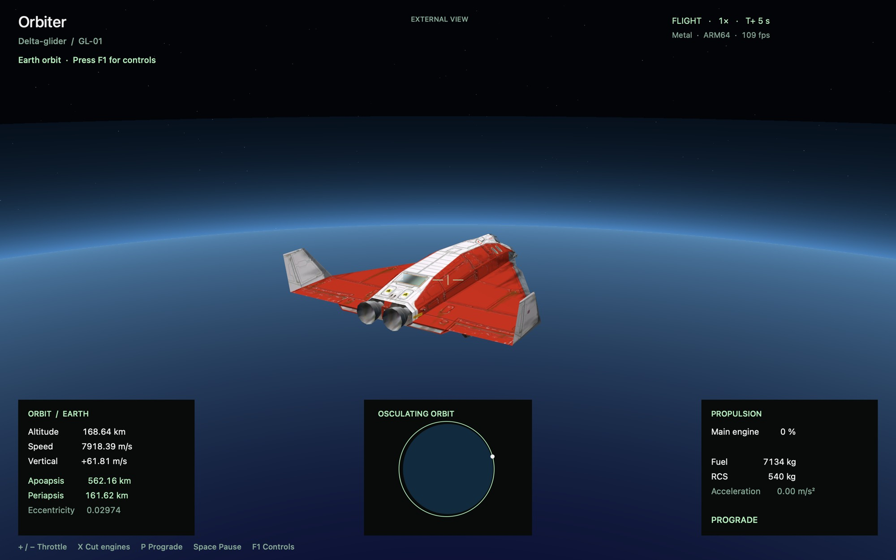
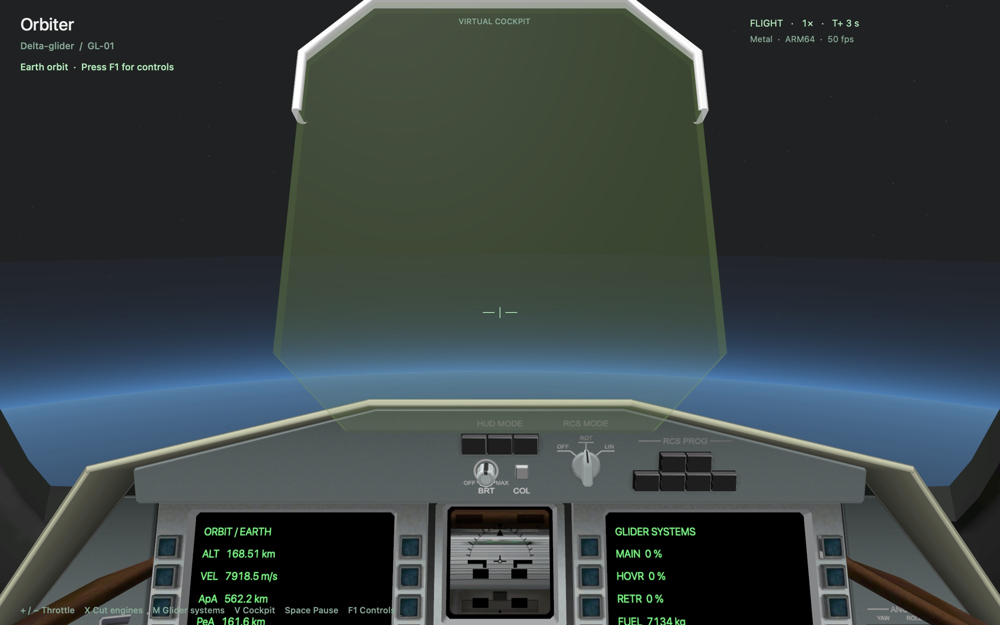
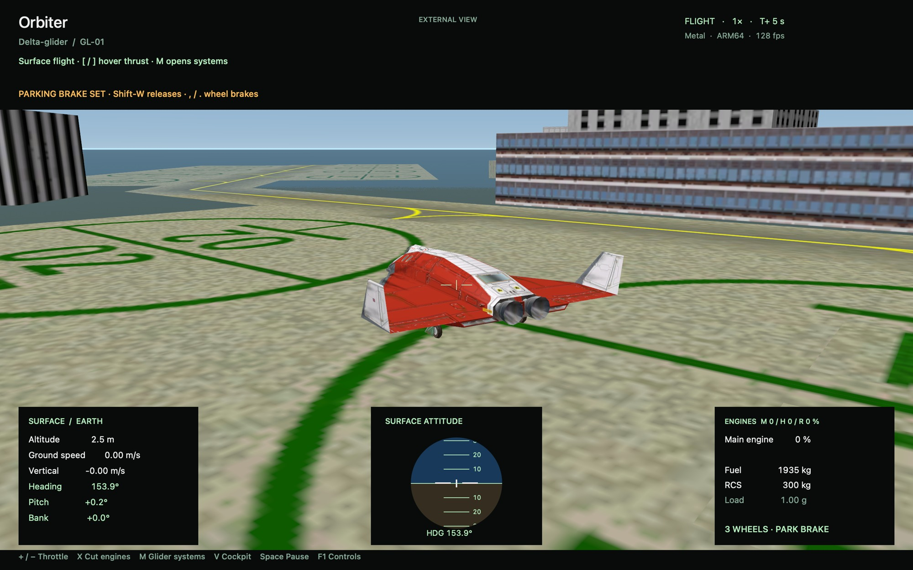
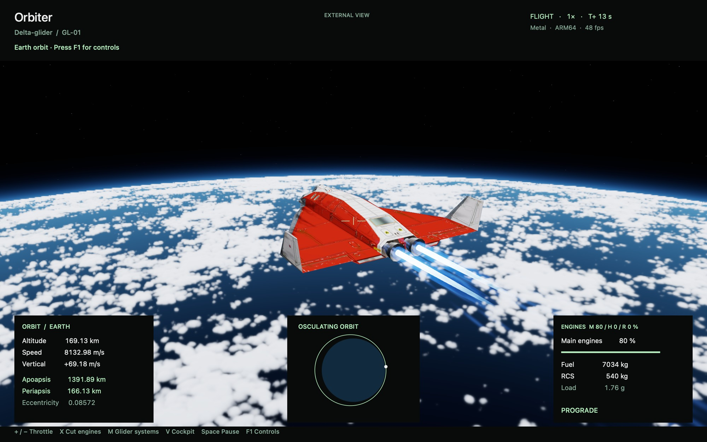
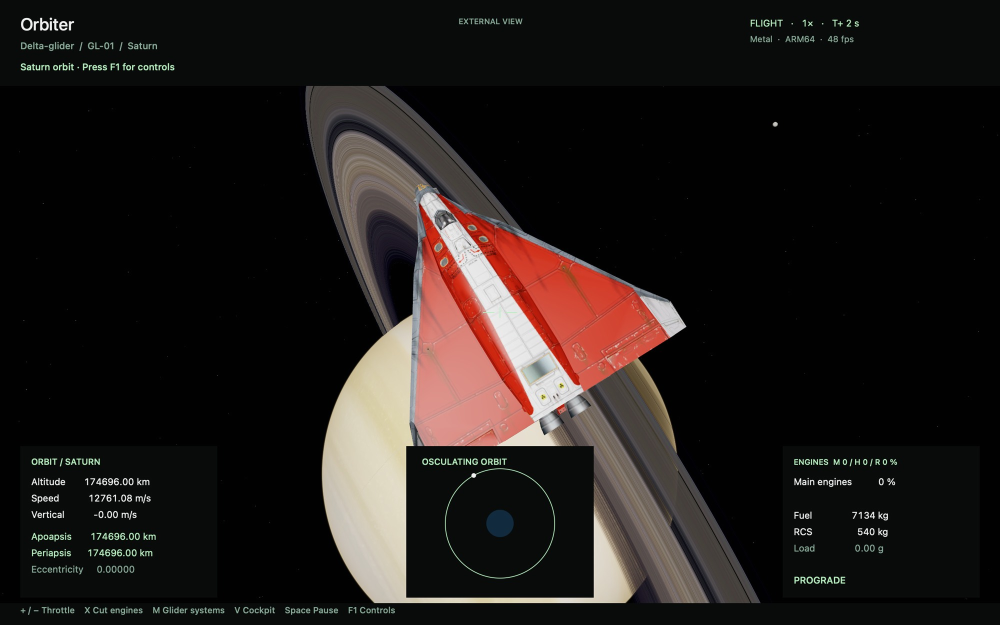
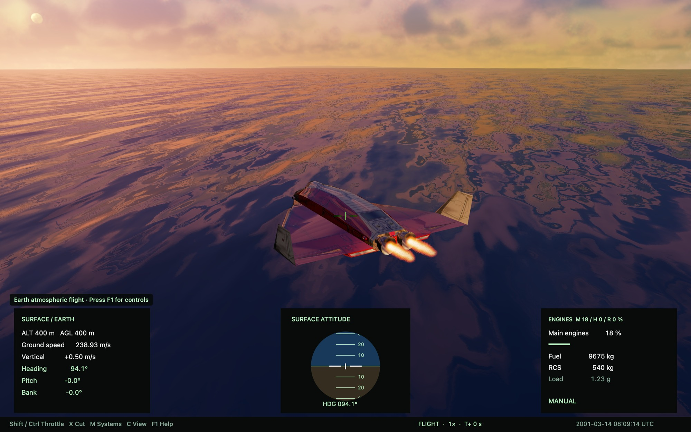
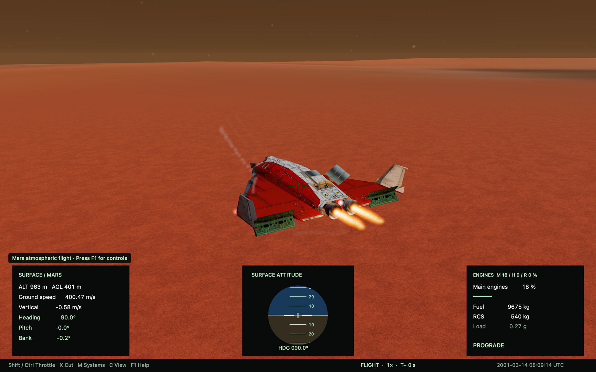

# I Wanted to Play an Old Space Simulator on My Mac. I Ended Up Rebuilding It With Codex.

*What started as a trip back to Orbiter became an experiment in bringing a Windows-era spaceflight simulator to Apple Silicon.*

A little while ago, I remembered a game I used to play a long time ago. Calling it a game is fair, but it was also something more specific: a spaceflight simulator called **Orbiter**.

I wanted to fly it again. There was one problem: I was on a Mac, and the version I had wasn't something I could just build and run natively on Apple Silicon.

So I opened the source code and asked Codex a simple question: “Do you think you can build this game for Apple Silicon?”

I thought I was asking for a port. I was. But as the project unfolded, “port” turned out to cover a much bigger adventure than I had imagined.

## The simulator I wanted back

[Orbiter](https://github.com/orbitersim/orbiter), created by Martin Schweiger and now open source, is a spaceflight simulator built around a real Solar System and orbital mechanics. You can fly spacecraft, work with orbits, and try to get from one place to another under rules that make spaceflight feel like spaceflight.

The spacecraft I kept coming back to was the **Delta-glider**: a winged vehicle that can fly through an atmosphere and also operate in space. It was a good place to start because getting even one familiar ship into orbit would mean seeing a piece of the old simulator alive again.

My original request was practical: make it run smoothly and natively on Apple Silicon. We agreed to start with a basic flight in one spacecraft and expand from there.

The first inspection made the difficulty clear. The source depended heavily on Windows: the application used Windows APIs, Direct3D for graphics, and platform-specific input and module systems. Building it for a Mac wasn't going to be a matter of changing a compiler setting.

## The first flight

The first playable milestone put the Delta-glider in Earth orbit. It had a native ARM64 executable and a Metal renderer, along with engine burns, fuel use, attitude controls, time acceleration, orbital instruments, camera controls, and support for saving and loading compatible scenarios.

*The first native prototype: one Delta-glider, one orbit, and a lot of simulator still to bring over.*

The picture was simple, but the milestone mattered. Something I remembered from years ago was moving on my Mac. And it wasn't just a spacecraft model floating in front of a planet: the prototype reused Orbiter's orbital calculations and original spacecraft geometry and textures, with a new, reduced flight layer around them.

That distinction became important. We weren't building a full native copy of the original engine. We were making a new macOS application around selected original code, data, and assets, then bringing features across piece by piece.

In an early 600-frame test on my M4 Max, the prototype averaged around 120 fps at 2560 × 1600. That was encouraging for the little scene we had at the time, although it wasn't a performance guarantee for the much more complicated version that followed.

## Getting back into the cockpit

Once the ship could fly, I wanted the parts that made it feel like the Delta-glider I remembered: the cockpit, controls, systems, and all the mechanisms that turn a spacecraft from a model into a machine.

The next iterations brought in the original cockpit and exterior meshes, staged animations, interactive controls, and more of the propulsion systems. Gear, doors, the nose, airlocks, the radiator, and other mechanisms could move. Main, hover, retro, and reaction-control thrusters became part of the flight experience.

*An early cockpit milestone. The view was becoming recognizable, even though many systems and instruments were still incomplete.*

Then we went down to the surface. A partial Cape Canaveral scene used original base configuration data, with pads, buildings, and runways. Ground handling and hover flight began to take shape, too.

*An early surface milestone, with a partial Cape Canaveral built from original configuration data.*

It was also becoming clear that this was a reconstruction as much as a port. The project retained Orbiter's source and reused parts of its mathematics, spacecraft assets, and system logic, but the native app, rendering, and a reduced flight layer were new. A lot of the original simulator still wasn't there.

## The Unreal detour

At some point I started thinking beyond simply getting the old simulator running. I wanted more detailed Earth imagery, weather, clouds, and realistic exhaust. We briefly tried an Unreal Engine frontend while keeping the flight simulation connected to it.

It was an interesting experiment, but I noticed that the camera no longer felt as smooth or responsive as it had in the native version. More importantly, I began wondering whether we needed Unreal at all for the visual effects I wanted.

I asked whether we could make volumetric clouds and particles in the native version. The answer was yes—with more rendering work, using Metal. So we removed the Unreal frontend and went back to the native app.

*Back in the native Metal renderer: Earth imagery, clouds, and thrust-driven exhaust in an early graphics milestone.*

That detour changed the project. The goal was still to fly Orbiter on a Mac, but now I also wanted to see how far we could take the world around it.

## Beyond Earth—and back to the original systems

After Earth came other planets and moons. The native project grew a Solar System catalogue, body-specific gravity and rotation, and scenarios around other bodies. Seeing the familiar glider near Saturn made the scale of the project feel different from that first orbit.

*An early Solar System milestone: the Delta-glider near Saturn.*

Navigation brought another correction to the direction of the work. We had started adding a transfer planner, but I wanted **TransX**, the tool from the original simulator. I wrote in the chat: “We are porting the game, not creating a new one, just a reminder.”

That became a useful rule for the project. The native version now connects the original TransX code to the native Solar System and glider state, with some Mac-friendly controls around it. It can help with planning and alignment, while engine burns remain manual. This is still an approximation of the broader Orbiter experience, not proof that every original mission or add-on works.

## Clouds, water, light, and a lot of small corrections

Once there was a world to fly through, I started paying attention to everything that didn't look right.

Clouds looked too transparent. The view from orbit and the view from nearby didn't always agree about how many clouds were there. The sunset looked too yellow. Rain on the cockpit needed to respond to speed. Exhaust sometimes looked like rigid sticks instead of gas coming from a nozzle.

These were the moments when the work became a conversation: I would fly, take a screenshot, point at the thing that bothered me, and ask Codex to change it. Sometimes the first fix wasn't enough. We would look again and adjust the next version.

The native renderer now has volumetric clouds, regional weather presets, atmospheric lighting, animated ocean shading, and exhaust effects driven by the ship's thrust. There are also newer experiments with sunlight, vessel shadows, water reflections, and higher-resolution planetary imagery. Some effects are approximations, and the weather isn't live meteorological data.

*The current native build in the Hawaii sunset scenario. This image was captured from the project after the later graphics iterations.*

The same cycle reached the ground. Early procedural land detail grew into trees, grass, rocks, and aerial terrain patterns. Gentle land and water landings were added, though the terrain is procedurally generated rather than a faithful map of local geography, and water handling remains simplified.

*The current native build over Mars, with the Delta-glider's mechanisms deployed.*

## Where it stands now

At this point, the project is a playable, experimental native Apple Silicon version centered on the Delta-glider. It has a 3D cockpit, a growing set of systems and controls, scenarios on and around Earth and other bodies, atmospheric flight, TransX navigation, and an ISS approach and docking scenario.

But it is **not a complete port of Orbiter**. The ISS scenario is a specific implementation, not general support for every vessel or docking situation. Ground handling and water landings are still experimental. Many original instruments, vessel systems, add-ons, scripting, sound, and Windows plug-ins are incomplete or unavailable. Visual improvements don't automatically mean the simulation matches every behavior of the original.

The work has also been uneven in the way real iteration often is: a feature gets added, a test passes, I try it, and then I notice something the test didn't catch. One example was terrain that appeared to crawl while the ship was stationary; it took another round of investigation and a targeted regression test to address the visible problem.

## What I actually made

I didn't create Orbiter. Martin Schweiger and the people who have worked on its open-source code and community did that. What I started was an attempt to bring some of it back to a machine I use today, with Codex doing much of the implementation while I set the direction, tried the results, and kept asking for changes.

I expected a straightforward port. Instead, I ended up watching a native Mac version grow around pieces of the original: its mathematics, code, spacecraft, textures, and ideas, joined by new platform code and a new renderer.

There is still a long way to go. For now, I can fly the Delta-glider again—and I have a much better appreciation of how much work hides behind the simple wish to revisit an old simulator.
